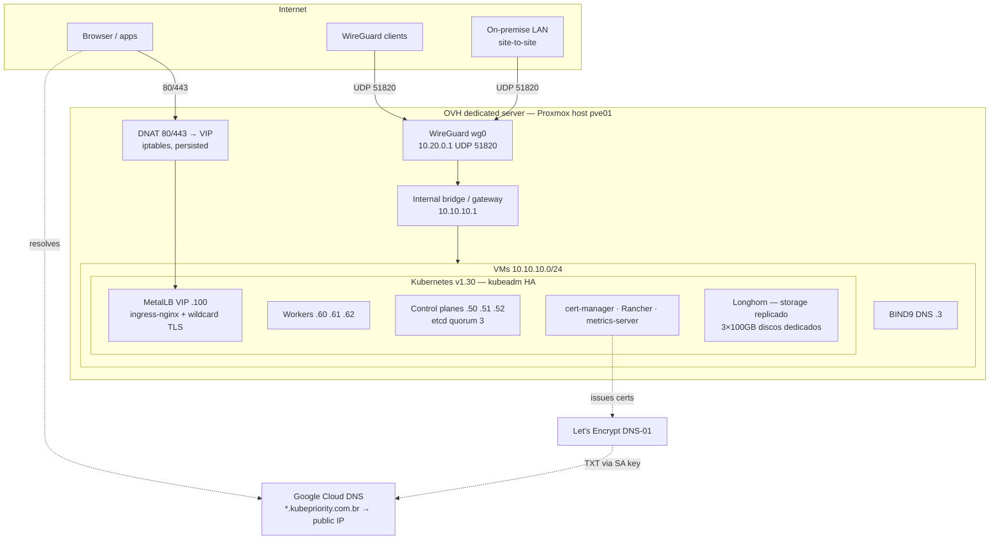

# Terraform Proxmox Kubernetes

Production-style Kubernetes on a single OVH dedicated server running Proxmox,
fully bootstrapped by one `terraform apply`: HA control plane, ingress with a
wildcard Let's Encrypt certificate, Rancher, metrics and a WireGuard VPN.

## ✅ Current Status (2026-07-10)

Everything below is **deployed and verified** on the live environment (OVH
dedicated server, `pve01`):

| Area | State |
|---|---|
| Cluster | kubeadm v1.30 HA — 3 control planes (etcd quorum 3), 3 workers, Calico |
| Ingress | MetalLB VIP `10.10.10.100` + ingress-nginx, DNAT 80/443 on the host |
| TLS | Wildcard `*.kubepriority.com.br` (Let's Encrypt DNS-01), auto-renewed, default cert |
| DNS | Cloud DNS apex + wildcard → public IP, managed by apply |
| Rancher | `https://rancher.kubepriority.com.br` (2.13.3, own cert via cert-manager) |
| Storage | Longhorn 1.12 — 3×100GB, 3 replicas, SCs `longhorn` (default), `longhorn-fs`, `longhorn-block` |
| Metrics | metrics-server (`kubectl top` working) |
| VPN | WireGuard on the host (UDP 51820), client `erik` active; site-to-site structure ready, waiting for the on-prem peer key/CIDR |
| Bootstrap | Single `terraform apply` rebuilds everything; component flags in tfvars |

Known gaps: Kubernetes API endpoint still points at control-plane-0
(`10.10.10.50:6443`) — kube-vip planned; see Coming Soon.

## 🛠️ Tech Stack

- **Terraform**: Infra as code — VMs, DNS, DNAT, VPN and all cluster addons.
- **Proxmox VE**: Hypervisor; the host also acts as router, NAT and VPN gateway.
- **Kubernetes (v1.30)**: Kubeadm HA (3 control planes / etcd quorum), Calico CNI.
- **Helm addons**: MetalLB (L2), ingress-nginx, cert-manager (DNS-01 wildcard via Google Cloud DNS), Rancher, metrics-server, Longhorn (replicated block/filesystem storage on the workers' dedicated 100GB disks — default StorageClass, PVC picks `volumeMode: Filesystem` or `Block`).
- **WireGuard**: Roadwarrior + site-to-site VPN on the Proxmox host.
- **BIND9**: Internal DNS for `homelab.local`.
- **Ubuntu 24.04 / containerd**: Base image and runtime.

## 📋 Prerequisites

Before you kick things off, make sure you’ve got:

- Proxmox VE 7.0+ up and running.
- Terraform 1.3+ installed locally.
- SSH key pair (put your public key in `[id_rsa.pub](id_rsa.pub)`).
- Proxmox API access with a user and password (or token, but we’re using password here).
- A network bridge (default `vmbr1`, configurable via `proxmox_network_bridge`) configured in Proxmox, with the CIDR of your choice (default `10.10.10.0/24`, configurable via `proxmox_network_prefix`). If the bridge is internal-only, enable NAT/IP forwarding on the Proxmox host so VMs reach the internet during cloud-init.
- Enough resources for VMs (e.g., 1 DNS VM, 1+ control plane, 3+ worker nodes).

## 🚀 Getting Started

### 1. Clone the Repo

Grab the code and hop into the directory:

```bash
git clone https://github.com/chrodrigues/terraform-proxmox-k8s
cd terraform-proxmox-k8s
```

### 2. Set Up Your Variables

You’ll need to configure variables for Proxmox and the K8s cluster. Create a file called `secret.auto.tfvars` (it’s gitignored, so your secrets are safe). Here’s an example:

```hcl
# Proxmox connection
proxmox_endpoint = "https://192.168.1.100:8006/api2/json"
proxmox_user_name = "root@pam"
proxmox_user_password = "your-super-secret-password"

# VM user
proxmox_vm_user = "Ubuntu"
proxmox_vm_password = "your-vm-password"

# Cluster config
proxmox_node_name = "proxmox"
proxmox_datastore_name = "local"
proxmox_network_bridge = "vmbr1"
proxmox_network_prefix = "10.10.10"
proxmox_number_of_vm_k8s_control_plane = "1"
proxmox_number_of_vm_k8s_worker_node = "3"
k8s_control_plane_ip_start = "50"  # First control plane IP: 10.10.10.50
k8s_worker_ip_start = "60"        # First worker IP: 10.10.10.60
```

Check out all variables in `[variables.tf](variables.tf)` for defaults and descriptions. Key ones to set:

- `proxmox_endpoint`: Your Proxmox API URL (e.g., `https://<proxmox-ip>:8006/api2/json`).
- `proxmox_user_name` and `proxmox_user_password`: API credentials.
- `proxmox_vm_user` and `proxmox_vm_password`: User for SSH into VMs.
- `k8s_control_plane_ip_start` and `k8s_worker_ip_start`: Starting IPs for control plane and worker nodes (e.g., `50` for `10.10.10.50`).
- `proxmox_number_of_vm_k8s_control_plane` and `proxmox_number_of_vm_k8s_worker_node`: Number of control plane and worker nodes.

### 3. Optional: DNS Server

This project includes a BIND9 DNS server module that sets up a VM at `10.10.10.3` for `homelab.local`. It’s super handy for local DNS resolution, but you don’t have to use it if you’ve got your own DNS server.

#### If you skip the DNS module:

- Comment out the `bind9_server` module in `[main.tf](main.tf)`:

  ```hcl
  # module "bind9_server" { ... }
  ```

- Update the `/etc/resolv.conf` in the Kubernetes module’s cloud-init config (`[modules/proxmox/main.tf](modules/proxmox/main.tf)`). Replace:

  ```yaml
  nameserver 10.10.10.3
  ```

  with your DNS server’s IP, like:

  ```yaml
  nameserver 192.168.1.1  # Your DNS server
  ```

- Make sure your DNS server resolves `homelab.local` or adjust the `/etc/hosts` in the same file to match your domain.

#### If you use the DNS module:

- It auto-configures a VM with BIND9, sets up forward and reverse zones for `homelab.local`, and uses Google’s DNS (`8.8.8.8`, `8.8.4.4`) as forwarders.
- No extra config needed unless you want to tweak the zones (see `[modules/bind9_dnsserver/main.tf](modules/bind9_dnsserver/main.tf)`).

### 4. Deploy the Cluster

Time to fire it up! Run these commands:

```bash
terraform init
terraform plan  # Check what’s gonna happen
terraform apply --auto-approve
```

This will:

- Spin up a DNS VM (if enabled) at `10.10.10.3`.
- Create control plane VMs (e.g., `k8s-control-plane-0` at `10.10.10.50`) and worker nodes (e.g., `k8s-worker-0` at `10.10.10.60`).
- Configure each VM with cloud-init to install containerd, kubeadm, and Calico CNI.
- Bootstrap the K8s cluster using kubeadm, with the first control plane node running a temporary HTTP server (port 8000) to share the join token.

### 5. Access Your Cluster

Once `terraform apply` finishes (takes ~7-12 minutes), SSH into the first control plane node (`k8s-control-plane-0`):

```bash
ssh ubuntu@10.10.10.50
```

Check the cluster:

```bash
export KUBECONFIG=/home/ubuntu/.kube/config
kubectl get nodes
```

You should see your control plane and worker nodes in `Ready` state. The kubeconfig is already set up at `/home/ubuntu/.kube/config` on the first control plane node.

### 6. Kubernetes Addons (MetalLB, ingress-nginx, cert-manager, Rancher)

Fully automated: the same `terraform apply` that creates the VMs also
bootstraps the addons. `bootstrap.tf` handles the glue steps that used to be
manual:

- `null_resource.cluster_access` — fetches the kubeconfig from the control
  plane via `qm guest exec` (no SSH key needed inside the VMs) and keeps an
  SSH tunnel to the cluster API on `127.0.0.1:6443`. Runs on every apply.
- `null_resource.proxmox_dnat` — DNATs ports 80/443 on the Proxmox host to
  the MetalLB VIP (`<network_prefix>.100`) and persists the rules.
- `null_resource.public_dns` — upserts the public `A` records (apex +
  wildcard) in Google Cloud DNS pointing to the Proxmox host.

All IPs are derived from `proxmox_endpoint` and `proxmox_network_prefix` —
point them at a new Proxmox host and everything follows.

**Prerequisites on the machine running Terraform:** `sshpass`, `jq`, `gcloud`,
plus two gitignored files: `secret.auto.tfvars` (credentials) and the GCP
service account key at
`kubernetes/lets-encrypt-dns-google/cert-manager-dns01.json`.

```bash
terraform init
terraform apply
```

Validate the wildcard certificate (DNS-01 issuance takes a few minutes):

```bash
KUBECONFIG=./kubeconfig kubectl -n ingress-nginx get certificate
# wait for READY=True, then:
curl -v https://anything.kubepriority.com.br
```

If the SSH tunnel drops (e.g. after a reboot) and `terraform plan` can't reach
the cluster, re-create it without applying:

```bash
PUBLIC_HOST=139.99.62.36 CP_IP=10.10.10.50 SSH_PASSWORD='<root pw>' ./scripts/ensure-access.sh
```

### 7. Optional components & VPN

Components can be toggled in `secret.auto.tfvars` (all default `true`):

```hcl
enable_rancher        = true
enable_metrics_server = true
enable_vpn            = true
```

`enable_vpn` sets up **WireGuard on the Proxmox host** (UDP 51820) for two
uses at once:

- **Roadwarrior clients**: list names in `vpn_clients = ["erik"]`; each apply
  generates `./vpn/<name>.conf` (gitignored — contains the private key).
  Import it into any WireGuard client and you reach `10.10.10.0/24` directly
  (kubectl, Proxmox UI, node SSH) with internal DNS via BIND9.
- **Site-to-site with on-premise**: set `vpn_site_peer_public_key` and
  `vpn_site_remote_cidr` (e.g. `192.168.0.0/24`) once the on-prem router has a
  WireGuard peer configured with this server's public key (printed at the end
  of the apply) and endpoint `<public-ip>:51820`, allowed IPs
  `10.10.10.0/24, 10.20.0.0/24`.

Keys live in `/etc/wireguard` on the host and are generated once; re-applies
only resync the peer list.

With the VPN up you can skip the SSH tunnel entirely: generate a direct
kubeconfig once and use it from any VPN-connected machine:

```bash
sed -e 's|server: https://127.0.0.1:6443|server: https://10.10.10.50:6443|' \
    -e '/tls-server-name: kubernetes/d' kubeconfig > kubeconfig-vpn
KUBECONFIG=./kubeconfig-vpn kubectl get nodes
```

### 8. Storage (Longhorn)

Longhorn provides replicated storage over the workers' dedicated data disks.
Capacity and replication live in `secret.auto.tfvars`:

```hcl
worker_data_disk_size = 100 # GB per worker (grow-only; shrinking recreates the VM)
longhorn_replicas     = 3   # copies of each volume (max = number of workers)
```

Usable pool ≈ `workers × disk ÷ replicas` (3×100 ÷ 3 ≈ 100GB). Volume **size is
set per PVC**, not on the StorageClass. Available classes:

| StorageClass | Use |
|---|---|
| `longhorn` (default) | PVC without a class lands here — filesystem |
| `longhorn-fs` | Named convention for filesystem volumes |
| `longhorn-block` | Named convention for raw block volumes |

`volumeMode` is always decided by the PVC (Kubernetes default: `Filesystem`).
A bare PVC gives you an ext4 volume with 3 replicas:

```yaml
apiVersion: v1
kind: PersistentVolumeClaim
metadata: { name: data }
spec:
  accessModes: [ReadWriteOnce]
  resources: { requests: { storage: 5Gi } }
```

Raw block device (app formats/consumes the device itself):

```yaml
apiVersion: v1
kind: PersistentVolumeClaim
metadata: { name: raw }
spec:
  storageClassName: longhorn-block
  volumeMode: Block
  accessModes: [ReadWriteOnce]
  resources: { requests: { storage: 5Gi } }
# no pod: volumeDevices: [{ name: raw, devicePath: /dev/xvda }]
```

Longhorn UI shows up inside Rancher (namespace `longhorn-system`). A volume
survives the loss of any single worker.

Any `Ingress` with a `tls` block automatically uses the wildcard certificate
(`--default-ssl-certificate`); no need to repeat `secretName`.

The module also installs **Rancher** at `https://rancher.kubepriority.com.br`
(chart 2.13.3, 1 replica). Initial admin login uses the bootstrap password set
in `secret.auto.tfvars` (`rancher_bootstrap_password`); its TLS certificate is
issued automatically by cert-manager via the ingress annotation.

## 🐛 Debugging Tips

If something goes wonky, don’t panic! Here’s how to troubleshoot:

- **Check Terraform logs**: Look at the output of `terraform apply` for errors (e.g., wrong Proxmox credentials).

- **VM logs**: SSH into a VM (e.g., `ssh ubuntu@10.10.10.50`) and check:

  - `/tmp/cloud-init.log`: Main log for Kubernetes setup (control plane/worker nodes).
  - `/tmp/dns-config.log`: DNS server setup log (if using BIND9 module).
  - `/tmp/kubeadm-init.log`: Kubeadm initialization log on the first control plane node.
  - `/tmp/http-server.log`: HTTP server logs for join token sharing.

- **DNS issues**:

  - Run `nslookup ns1.homelab.local 10.10.10.3` on a VM to test DNS resolution.
  - If using your own DNS, verify `/etc/resolv.conf` has the right `nameserver`.

- **Kubernetes issues**:

  - Check `kubectl get pods -A` to see if Calico or other pods are crashing.
  - Run `journalctl -u kubelet` on a node to debug kubelet issues.

- **Proxmox console**: Use the Proxmox UI to check VM status or console output if SSH fails.

- **HTTP server woes**: If nodes can’t join, ensure port 8000 is open on the first control plane node (`ufw allow 8000/tcp`) and check `/tmp/k8s-join-token`.

If you’re stuck, open an issue or ping me!

## 📂 Project Structure

Here’s a quick rundown of the repo’s layout:

### Root:

- `[main.tf](main.tf)`: Calls the `bind9_server` and `proxmox` modules.
- `[provider.tf](provider.tf)`: Configures the Proxmox provider.
- `[variables.tf](variables.tf)`: Defines all variables (with defaults).
- `[secret.auto.tfvars](secret.auto.tfvars)`: Your sensitive creds (gitignored for safety).
- `[secret.auto.tfvars.example](secret.auto.tfvars.example)`: Annotated template — copy, fill in, done.
- `[id_rsa.pub](id_rsa.pub)`: SSH public key for VM access.
- `[LICENSE](LICENSE)`: License file (consider using MIT if not set).
- `.terraform/`, `terraform.tfstate`, etc.: Auto-generated by Terraform.

### Modules:

- `[modules/bind9_dnsserver/](modules/bind9_dnsserver/)`: Sets up the BIND9 DNS server.
- `[modules/proxmox/](modules/proxmox/)`: Deploys the Kubernetes cluster VMs.
- `[modules/k8s-addons/](modules/k8s-addons/)`: Installs MetalLB, ingress-nginx and cert-manager (wildcard TLS) via Helm.
- `[charts/](charts/)`: Local helper charts (`metallb-config`, `cert-infra`, `longhorn-classes`) applied by the `k8s-addons` module.
- `[scripts/](scripts/)`: `ensure-access.sh` (kubeconfig + API tunnel) and `update-dns.sh` (Cloud DNS upsert), both driven by `bootstrap.tf`.
- `[bootstrap.tf](bootstrap.tf)`: glue automation — cluster access, DNAT on the Proxmox host, public DNS records.

The `[.gitignore](.gitignore)` ensures sensitive files like `secret.auto.tfvars` and Terraform state aren’t versioned. Keep it that way for security! 🔒

## 📊 Architecture



- **Single public IP**: the Proxmox host is router, NAT, DNAT and VPN gateway for everything behind it.
- **HA control plane**: 3× kubeadm control planes, etcd tolerates the loss of one node. (API endpoint still points at `.50` — kube-vip is the planned fix.)
- **Ingress**: MetalLB (L2) answers ARP for the VIP `.100`; ingress-nginx serves every `Ingress` with the wildcard `*.kubepriority.com.br` certificate by default.
- **Certificates**: cert-manager issues/renews via DNS-01 on Google Cloud DNS (service-account key, never committed).
- **VPN**: WireGuard on the host — client `.conf` files generated per apply, optional site-to-site peer to on-premise.
- **Pod networking**: Calico, pod subnet `10.45.0.0/16`, VXLAN.

## 🔮 Coming Soon

- **kube-vip**: floating VIP for the Kubernetes API (today the endpoint is control-plane-0's IP).
- **Second Proxmox host**: vRack L2 span, MetalLB across hosts, OVH LB in front.
- **IA Node**: dedicated node for AI workloads (maybe with Ollama).

## 📬 Contributing

Got ideas? Found a bug? Open an issue or submit a PR. Check our `[guidelines](CONTRIBUTING.md)` for the deets.